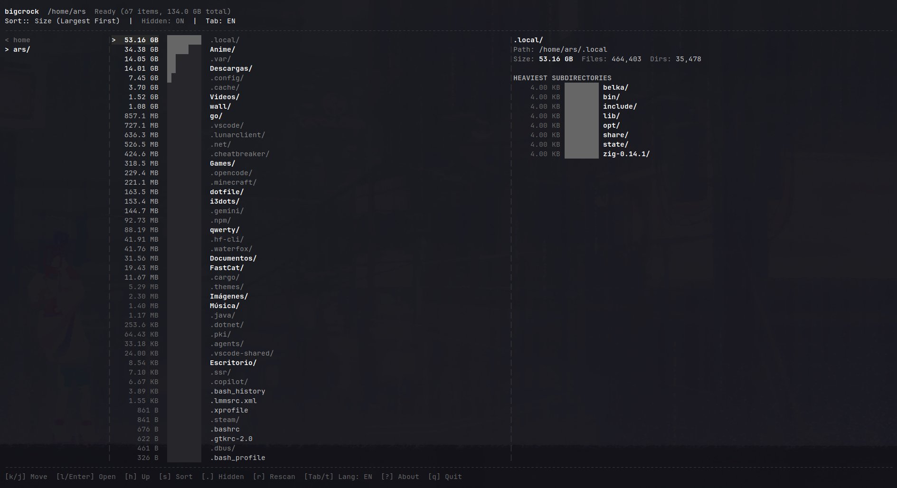

# bigcrock

[](https://go.dev/)
[](LICENSE)
[](https://github.com/Ars-byte/Bigcrock/releases)

> **Idioma / Language**: **Español** | [English](README.md)

**bigcrock** es un analizador de uso de disco y ranking de carpetas en árbol, rápido, minimalista e inspirado en Ranger, escrito en Go.

---

## Vista previa



---

## Características

- **Columnas Miller**: Vista en 3 paneles estilo Ranger con redimensión automática.
- **Ranking por peso**: Carpetas y archivos ordenados de mayor a menor consumo.
- **Archivos ocultos**: Inspección directa de `.local`, `.cache` y rutas ocultas.
- **Bajo consumo**: Escáner acotado sin bloqueos, bajo consumo de CPU y disco.
- **TUI minimalista**: Estética limpia en blanco y escala de grises sin ruido visual.
- **Bilingüe**: Alterna al instante entre inglés y español (`Tab` / `t`).

---

## Atajos de teclado

| Tecla | Acción |
| --- | --- |
| `k` / `j` | Mover cursor arriba / abajo |
| `l` / `Enter` | Entrar al directorio |
| `h` / `Backspace` | Subir al directorio padre |
| `g` / `G` | Ir al primero (#1 más pesado) / último |
| `s` | Cambiar orden (Peso / Nombre / Cantidad) |
| `.` / `H` | Mostrar / ocultar elementos ocultos |
| `r` | Re-escanear directorio |
| `Tab` / `t` | Cambiar idioma (EN ↔ ES) |
| `?` / `a` | Acerca de |
| `q` | Salir |

---

## Instalación

### Descargar binario
```bash
curl -L -o bigcrock https://github.com/Ars-byte/Bigcrock/releases/latest/download/bigcrock.bin
chmod +x bigcrock
sudo mv bigcrock /usr/local/bin/
```

### Compilar desde el código fuente
```bash
git clone https://github.com/Ars-byte/Bigcrock.git
cd Bigcrock
go build -ldflags="-s -w" -o bigcrock .
./bigcrock
```

---

## Licencia

Licencia MIT - consulta [LICENSE](LICENSE).
