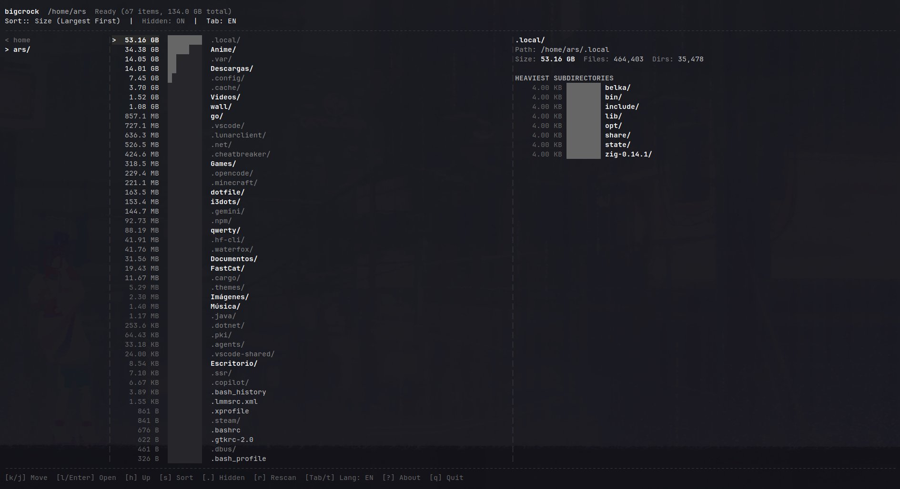

# bigcrock

[](https://go.dev/)
[](LICENSE)
[](https://github.com/Ars-byte/Bigcrock/releases)

> **Language / Idioma**: **English** | [Español](README.es.md)

**bigcrock** is a fast, minimalist, Ranger-inspired terminal directory tree analyzer and disk usage ranker written in Go.

---

## Preview



---

## Features

- **Miller Columns**: 3-panel Ranger-style view with responsive auto-resizing.
- **Disk Usage Ranking**: Top space consumers ranked from largest to smallest.
- **Hidden Items**: Full visibility into `.local`, `.cache`, and hidden directories.
- **Low Resource Usage**: Bounded background scanner keeps CPU and disk I/O minimal.
- **Minimalist TUI**: Clean monochrome grayscale interface with zero visual clutter.
- **Bilingual**: Instant English and Spanish toggle (`Tab` / `t`).

---

## Keybindings

| Key | Action |
| --- | --- |
| `k` / `j` | Move cursor up / down |
| `l` / `Enter` | Enter directory |
| `h` / `Backspace` | Up to parent directory |
| `g` / `G` | Jump to top (#1 heaviest) / bottom |
| `s` | Cycle sort (Size / Name / Count) |
| `.` / `H` | Toggle hidden items |
| `r` | Rescan directory |
| `Tab` / `t` | Toggle language (EN ↔ ES) |
| `?` / `a` | About modal |
| `q` | Quit |

---

## Installation

### Pre-built Binary
```bash
curl -L -o bigcrock https://github.com/Ars-byte/Bigcrock/releases/latest/download/bigcrock.bin
chmod +x bigcrock
sudo mv bigcrock /usr/local/bin/
```

### Build from Source
```bash
git clone https://github.com/Ars-byte/Bigcrock.git
cd Bigcrock
go build -ldflags="-s -w" -o bigcrock .
./bigcrock
```

---

## License

MIT License - see [LICENSE](LICENSE).
